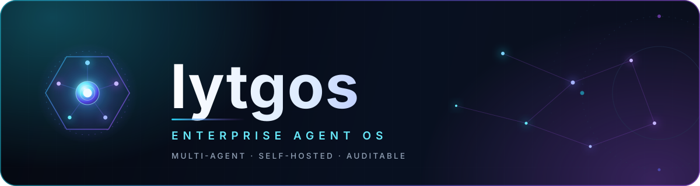
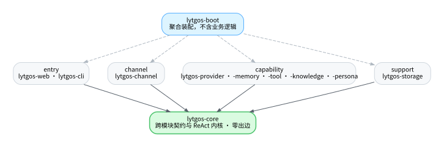

<p align="center">
  
</p>

<p align="center">
  <em>让每一个 Agent 都在治理之内运行</em>
</p>

<p align="center">
  <a href="LICENSE"></a>
  <a href="https://openjdk.org/projects/jdk/21/"></a>
  <a href="https://spring.io/projects/spring-boot"></a>
  <a href="#roadmap"></a>
  <a href="../../issues"></a>
</p>

---

**lytgos** 是一个基于 **Java 21** 实现、面向企业场景的 **Agent OS（智能体操作系统）**。它部署在企业自己的 K8s、虚拟机或物理机上，作为统一底座运行多个业务 Agent，共享模型接入、工具调用、记忆、渠道、沙箱与审计能力。数据完全留在企业自己的基础设施内，不绑定任何云生态。

> **Agent OS 不是 Agent Runtime。** Runtime 让单个 Agent 跑起来；Agent OS 让一群 Agent 在企业里被管起来——多 Agent 生命周期、统一接入、统一记忆、统一治理、完整审计。

## 目录

- [为什么是 lytgos](#为什么是-lytgos)
- [核心能力](#核心能力)
- [架构](#架构)
- [模块](#模块)
- [技术栈](#技术栈)
- [快速开始](#快速开始)
- [定义一个 Agent](#定义一个-agent)
- [命令行](#命令行)
- [REST API](#rest-api)
- [当前状态](#当前状态)
- [路线图](#路线图)
- [参与贡献](#参与贡献)
- [文档](#文档)
- [许可证](#许可证)

## 为什么是 lytgos

企业落地 Agent 通常这样开始：用框架跑通一个 Demo，然后想接第二个业务、第二个团队。问题从这里出现：

- **治理挂不上执行路径。** 框架自己完成整个推理与工具调用过程，配额、白名单、沙箱、审计没有地方可插，只能在框架外面看日志。
- **审计永远是补丁。** 先跑通再补，补的时候发现记录里缺了用量、耗时与调用链路，只能改架构重来。

lytgos 把这两件事放进内核：**推理与工具执行由自己掌控，审计记录从第一天就写入。**

> **核心原则：应用可以自由组合能力，但不能绕过治理。** 每一次模型调用与工具执行，都走同一条带白名单、沙箱与审计的路径。

三个设计取向：

| 取向 | 含义 |
|---|---|
| **统一** | 企业内多个 Agent 共享同一套底座，新增 Agent 只需放一个目录，不重复接渠道、模型和工具 |
| **私有** | 数据不出企业基础设施，支持自托管模型（Ollama、vLLM）与本地部署 |
| **可观测** | 每次 LLM 调用与工具执行完整留痕，治理在执行路径上，而非事后补日志 |

## 核心能力

| 能力 | 提供什么 |
|---|---|
| **Agent 运行时** | 一个目录定义一个 Agent，声明模型、工具与渠道；多个 Agent 在同一实例并存、互不干扰 |
| **模型接入** | 统一的 Provider 抽象，Agent 不感知具体厂商；切换模型只改配置，无供应商锁定 |
| **ReAct 循环** | 自实现的 Reason + Act 引擎，Agent 自主决定是否调用工具、调用哪个工具，多步骤任务一次完成 |
| **记忆系统** | 会话记忆 + 长期记忆（`MEMORY.md`）跨对话留存偏好与决策；记忆后端可插拔 |
| **工具与扩展** | 内置文件、命令、网络、记忆、通知能力；兼容 MCP 生态；零代码 / 轻代码 / 重代码三档扩展 |
| **治理与审计** | 沙箱白名单覆盖全部工具调用，每次模型调用与工具执行完整留痕，可追溯、可审计 |
| **多渠道接入** | 命令行、REST API，飞书、企微、钉钉等 IM 渠道按需扩展；同一份配置任意渠道可用 |

## 架构

```text
接入层   CLI · REST API · 定时任务 · 飞书 / 企微 / 钉钉
            │
            ▼
内核层   AgentService · ReActLoop · PromptBuilder · ToolExecutor · ContextLoader
            │
            ▼
能力层   Provider · Memory · Tool · Knowledge · Persona
            │
            ▼
支撑层   Storage（SQLite）· Boot 装配
```

- **接入层** 只负责把外部消息转换进来，同一份 Agent 配置在任何渠道可用
- **内核层** 不依赖任何能力模块，定义全部跨模块契约，新增能力只加模块、不改内核
- **能力层** 各能力彼此独立，可单独替换实现
- **支撑层** 负责持久化与启动装配，单进程、单二进制部署

一次消息处理的完整链路：

```text
消息进入
  → AgentService 组装上下文（Bootstrap + Agent 指令 + Skill 元数据 + 记忆 + 历史）
  → Provider 调用 LLM（写 llm_calls）
  → 有工具调用？ → ToolExecutor 校验沙箱 → 执行 → 写 tool_invocations → 结果回填
  → 循环直到最终响应（默认最多 10 轮）
```

## 模块

| 模块 | 职责 |
|---|---|
| `lytgos-core` | 跨模块契约与内核：`AgentService`、`ReActLoop`、`PromptBuilder`、`ToolExecutor`、`ContextLoader` |
| `lytgos-provider` | LLM 接入：Provider 显式映射、Function Calling 适配 |
| `lytgos-memory` | 记忆：`MemoryService` 门面、长期记忆多档后端、记忆工具 |
| `lytgos-knowledge` | 知识库：解析、切分、索引、检索与知识工具 |
| `lytgos-persona` | 人格库：内置模板与自定义人格管理 |
| `lytgos-tool` | 工具：内置工具、MCP Client、ToolRegistry、Sandbox |
| `lytgos-storage` | 持久化：会话、审计表、schema 迁移 |
| `lytgos-channel` | 渠道适配器：命令行、飞书、企微、钉钉等入口 |
| `lytgos-web` | REST API 与 OpenAPI 文档 |
| `lytgos-cli` | Picocli 命令行入口 |
| `lytgos-boot` | Spring Boot 启动与自动配置、依赖聚合 |

模块之间通过接口解耦，跨模块契约放在 `lytgos-core`，由下游模块实现（依赖倒置），不允许循环依赖。



图的数据源是 [`module-dependencies.dot`](docs/architecture/module-dependencies.dot)，改图先改 `.dot` 再重新生成 `.svg`。

## 技术栈

| 层 | 选型 |
|---|---|
| 语言 / 运行时 | Java 21（Virtual Thread） |
| 框架 | Spring Boot 4.1.x |
| 模型接入 | Spring AI（仅协议转换与 Schema 生成，禁用自动工具执行） |
| HTTP 服务 | Spring MVC + Java 21 Virtual Thread |
| 命令行 | Picocli |
| 持久化 | SQLite（默认零配置）+ MyBatis + Flyway |
| 日志 | Logback + SLF4J（结构化 JSON） |
| 构建与部署 | Maven 多模块，单进程 fat jar；可选 Docker / Helm |

> Spring AI 在 lytgos 中**只做两件事**：LLM 协议转换和 `@Tool` 的 JSON Schema 生成。工具调度与执行完全由 `ReActLoop` + `ToolExecutor` 掌控，否则治理无法挂上执行路径。

## 快速开始

**环境要求：** JDK 21+、Maven 3.9+。

```bash
git clone https://github.com/luyitiger6/lytgos.git
cd lytgos

# 构建（产出可执行 lytgos.jar）
mvn clean package

# 启动
java -jar lytgos-boot/target/lytgos.jar
```

仓库质量闸门（Windows PowerShell）：

```powershell
powershell -File harness/run-all.ps1
```

退出码 `0` 表示全部闸门真实通过；`2` 表示前置条件尚未就绪；其他非零为失败。

## 定义一个 Agent

一个目录就是一个 Agent。`AGENT.md` 的 frontmatter 是运行配置，正文是任务指令：

```markdown
---
name: ops-agent
description: 运维助手
provider:
  name: deepseek
  model: deepseek-chat
  api_key: ${DEEPSEEK_API_KEY}
tools:
  - read_file
  - shell
  - http_get
  - save_memory
  - recall_memory
channels:
  - name: cli
bootstrap:
  - AGENTS.md
  - SOUL.md
  - USER.md
settings:
  max_iterations: 10
  max_history_turns: 20
---

你是一个专业的运维助手。收到告警后先查询日志，再结合历史故障记录给出处理建议。
```

运行时工作区结构：

```text
.lytgos/
├── agents/          # 每个子目录 = 一个 Agent（AGENT.md + skills/ + scripts/）
├── skills/          # 公共 Skill 实体库
├── memory/
│   └── MEMORY.md    # 长期记忆
├── sessions/        # 会话数据
├── logs/            # 结构化日志
├── lytgos.db        # SQLite
├── AGENTS.md        # 项目级 Agent 行为说明
├── SOUL.md          # Agent 人格定义
└── USER.md          # 用户偏好（只读）
```

## 命令行

```bash
lytgos init                      # 初始化工作区
lytgos status                    # 查看运行状态
lytgos chat [--profile <name>]   # 交互式对话
lytgos serve [--port 8081]       # 启动 REST API 服务
lytgos gateway                   # 常驻守护，同时挂多个渠道

lytgos profile list              # 列出全部 Agent
lytgos profile create <name>     # 创建 Agent
lytgos profile show <name>       # 查看 Agent 配置
lytgos profile delete <name>     # 删除 Agent

lytgos provider list             # 查看已配置模型
lytgos tool list                 # 查看可用工具
lytgos session list              # 查看会话历史
```

## REST API

核心端点统一前缀 `/api/v1`：

| 方法 | 路径 | 说明 |
|---|---|---|
| `POST` | `/sessions` | 创建会话 |
| `POST` | `/sessions/{id}/messages` | 发送消息（触发 ReAct 循环） |
| `GET` | `/sessions/{id}` | 查询会话历史 |
| `DELETE` | `/sessions/{id}` | 归档会话 |
| `POST` | `/agents/{name}/invoke` | 无状态调用 Agent |
| `GET` | `/profiles` | 列出 Agent / Profile |
| `GET` | `/memory` | 查询长期记忆 |
| `GET` | `/tools` | 列出可用工具 |
| `GET` | `/health` | 健康检查 |
| `GET` | `/info` | 运行信息与 Provider 状态 |

任何能发 HTTP 请求的语言都可以接入，不绑定 SDK。

## 当前状态

lytgos 目前处于**骨架阶段**：

- 11 个 Maven 模块已就位，`mvn clean package` 可产出三个可执行入口：`lytgos.jar`（完整装配）、`lytgos-cli-boot.jar`（命令行）、`lytgos-channel-boot.jar`（渠道，监听 8081）
- 需求、技术方案、架构与 AI 编程指南已完成，作为内部设计资料维护
- 业务实现按 OpenSpec change 逐个推进，先规格后代码
- 质量闸门（Harness）已启用，未接入的闸门会显式返回 `NOT_READY`，不伪造绿灯

## 路线图

**核心阶段（运行时内核）**

- [x] 项目骨架与工程约束
- [ ] Provider 抽象与 ReAct 循环
- [ ] Memory 会话 + 长期记忆
- [ ] 内置工具 + MCP Client + Sandbox
- [ ] CLI、REST API 与定时触发
- [ ] SQLite 持久化与 Day-one 审计落库
- [ ] 端到端 Demo：每日天气、每日科技日报

**扩展阶段（企业治理层）**

- [ ] 飞书 / 企微 / 钉钉 / Slack 等多渠道
- [ ] Provider Fallback、熔断与自适应路由
- [ ] 语义记忆、知识库与向量检索
- [ ] Tool Policy、完整容器级 Sandbox
- [ ] 多租户、SSO、RBAC、完整审计与 SIEM 导出
- [ ] Prometheus、Grafana、Web 管理台
- [ ] 集群化部署与高可用

## 参与贡献

1. 阅读 [`AGENTS.md`](AGENTS.md) 了解仓库约束与三层分工
2. 在 `openspec/changes/<change-id>/` 下提交 proposal 与 tasks
3. 从 `main` 拉出 `feat/<简述>-<yyyyMMdd>` 或 `fix/<简述>-<yyyyMMdd>` 分支
4. 完成实现与验证，确保 `harness/run-all.ps1` 通过
5. 提交 PR，等待 Review 与合并

欢迎通过 Issue 报告问题、提出需求，或参与路线图中的社区共建项。

## 文档

| 文档 | 内容 |
|---|---|
| [`AGENTS.md`](AGENTS.md) | 仓库对 AI 与贡献者的入口契约：三层分工、硬规则、标准工作流 |

## 许可证

[Apache License 2.0](LICENSE)
